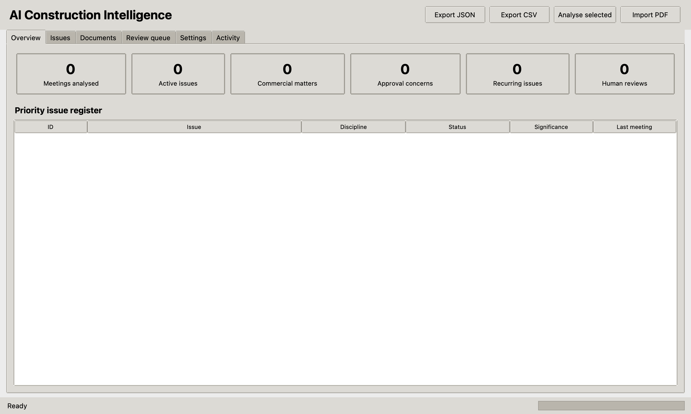
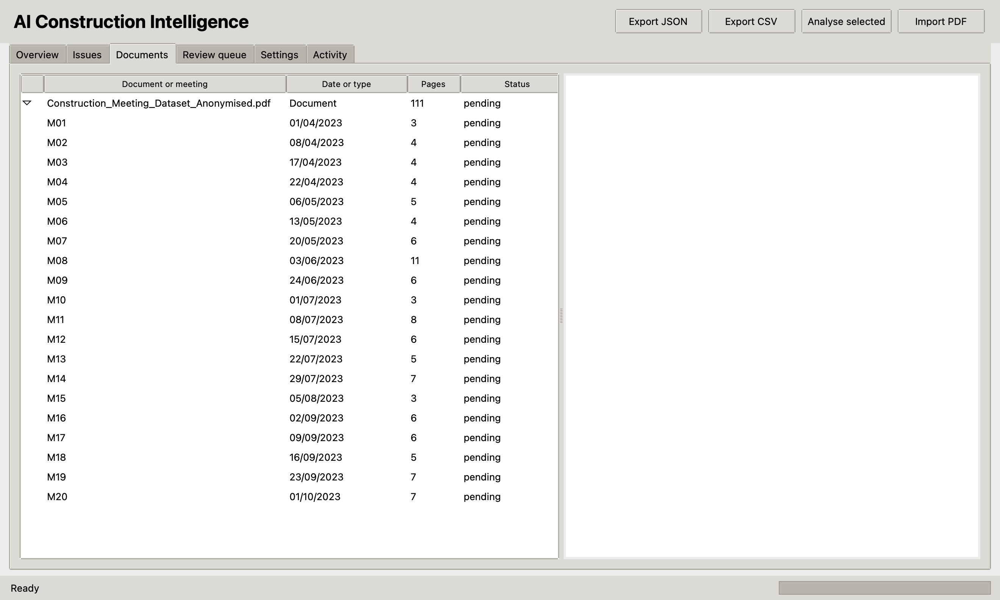

# AI Construction Intelligence

A simple Python desktop app that reads construction meeting PDFs and turns them into a tracked issue register.

## Screenshots





## What it does

- Imports meeting-minute PDFs
- Uses Gemini to find technical and project issues
- Keeps evidence pages and issue history
- Exports results to JSON or CSV

## Run it

Python 3.11 or newer is required.

```bash
python3 -m venv .venv
source .venv/bin/activate
python -m pip install -r requirements.txt
python main.py
```

Then:

1. Open **Settings** and enter a Gemini API key.
2. Click **Import PDF**.
3. Select the document and click **Analyse selected**.
4. Review the issues or export them.

The API key is kept in memory and is not saved in the project.

## Tests

```bash
source .venv/bin/activate
python -m unittest discover -v
```
